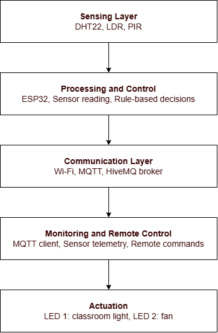
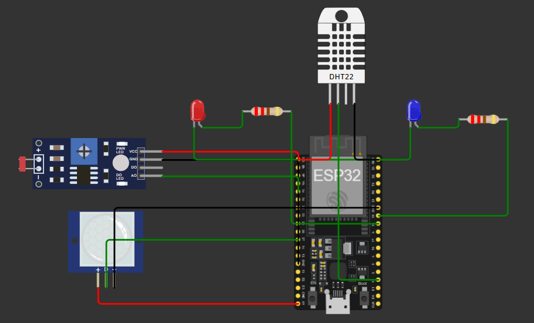
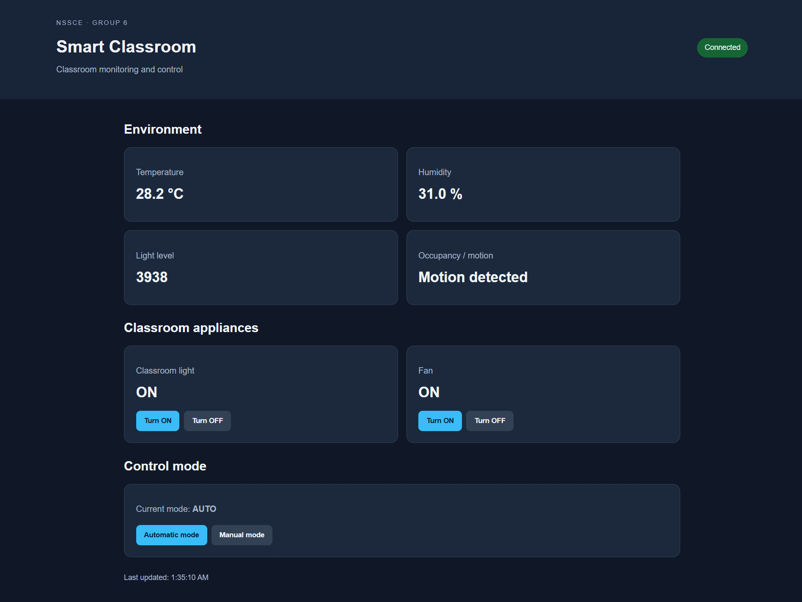
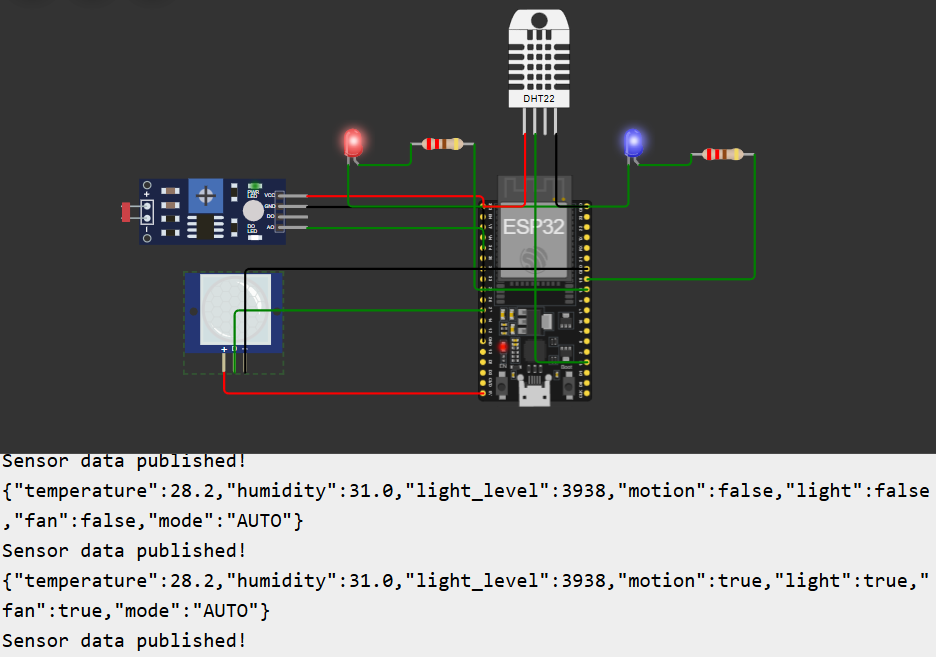

# Smart Classroom Management System

An IoT-based Smart Classroom Management System that uses ESP32, environmental sensors, and MQTT to monitor classroom conditions, automate lighting and fan control, and enable remote device management.

## Overview

The system monitors classroom temperature, humidity, ambient light, and motion using a DHT22 sensor, an LDR, and a PIR sensor. An ESP32 processes the sensor readings and controls simulated classroom appliances based on predefined conditions. Sensor data and device status are transmitted to the web dashboard for real-time monitoring and remote control

MQTT communication through the HiveMQ public broker enables real-time telemetry monitoring and remote control using commands such as `LIGHT_ON`, `LIGHT_OFF`, `FAN_ON`, `FAN_OFF`, `AUTO`, and `MANUAL`.

The project is implemented and tested in the Wokwi ESP32 simulator.

## Features

- Real-time temperature and humidity monitoring
- Ambient light-level measurement
- Motion detection for classroom activity
- Automatic lighting based on motion and light level
- Automatic fan control based on motion and temperature
- MQTT-based sensor data publishing
- Remote appliance control through MQTT commands
- Automatic and manual operating modes

## System Architecture



## Circuit Diagram



## Dashboard



## Working



## Hardware Components

| Component | Purpose |
|---|---|
| ESP32 | Main controller and Wi-Fi communication |
| DHT22 | Temperature and humidity sensing |
| LDR | Ambient light-level sensing |
| PIR sensor | Motion detection |
| LEDs with resistors | Simulated classroom light and fan indicators |

## Technologies Used

- **Microcontroller:** ESP32
- **Simulation:** Wokwi
- **Programming:** Arduino C++
- **Sensors:** DHT22, LDR, PIR
- **Communication:** Wi-Fi and MQTT
- **MQTT Broker:** HiveMQ
- **Libraries:** WiFi, PubSubClient, DHTesp

## MQTT Configuration

**Telemetry topic**
```text
nssce/smartclassroom/group6/test
```

Publishes sensor readings and appliance status as JSON.

**Command topic**
```text
nssce/smartclassroom/group6/command
```

Receives remote-control commands for the simulated appliances and operating mode.


## Repository Structure

```text
smart-classroom-management/
├── sketch.ino
├── diagram.json
├── libraries.txt
├── index.html
├── style.css
├── script.js
├── README.md
└── pictures/
    ├── circuit_diagram.png
    ├── dashboard.png
    ├── architecture_diagram.png
    └── working.png
```

## Future Scope

- Develop a fully integrated web dashboard
- Store historical sensor data and display analytics
- Integrate air-quality sensors and energy monitoring
- Add RFID-based attendance management
- Implement secure MQTT authentication and access control
- Deploy the system on physical hardware with appropriate appliance drivers and safety measures

## Conclusion

The project demonstrates how IoT sensing, ESP32-based automation, and MQTT communication can support a smarter and more energy-efficient classroom environment. The Wokwi simulation provides a foundation for future development and real-world deployment.